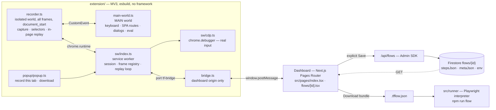
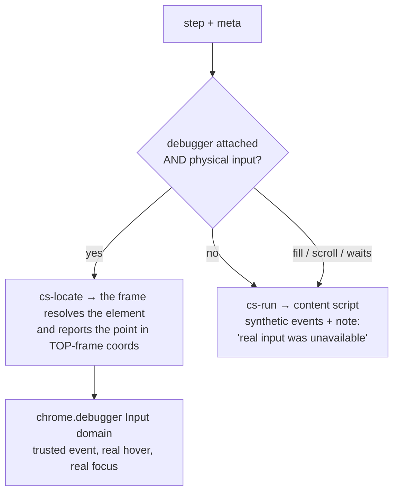

# TestFlow — Architecture

**Status:** describes the system as built. **Last updated:** 2026-08-04

Companion documents, so this one does not repeat them:

| Document | Scope |
|---|---|
| [EXTENSION.md](EXTENSION.md) | Extension internals, mechanism by mechanism |
| [REPORT.md](REPORT.md) | What each build phase delivered, and the judgement calls |
| [GUIDE.md](GUIDE.md) | Plain-English tour for someone using it |
| [SETUP.md](SETUP.md) | Install, Firebase, sign-in, dashboard origins |
| [UPGRADE.md](UPGRADE.md) | Weak-point audit — known gaps, prioritised |

---

## 1. The premise

A recording is worth something only if replaying it means the same thing every time and
in every engine. Two claims follow from that, and everything below is built to make
them true:

1. **A recording is not a list of actions.** It is a list of actions *plus* where each
   one happened (tab, frame, scroll offset) *plus* the environment it happened in
   (viewport, DPR, fonts, locale, timezone). Actions alone can be re-performed; they
   cannot be reproduced.
2. **Two executors, one meaning.** The in-browser replayer and the Playwright runner
   must resolve the same step to the same element, refuse the same occluded clicks, and
   pace the same way. Where they cannot agree, the difference is *reported*, never
   absorbed.

The corollary — repeated throughout the code — is that a silent downgrade is the worst
possible outcome. A green step that did nothing is more expensive than a red one.

---

## 2. Component map



Two executors hang off one flow format. Neither is a fallback for the other: the
extension replays *in the user's own browser on the real site*, the runner replays
*headless/headed in CI with a sealed network and a pinned clock*.

### Where the code lives

```
src/
├─ types/flow.ts        # THE contract: FlowJson, StepMeta, EnvRecord, message protocol
├─ shared/
│  ├─ resolve.ts        # consensus element resolver — shipped into the page by BOTH engines
│  ├─ env.ts            # captureEnv() — run at record time AND at replay time
│  └─ expressions.ts    # evaluate the recorder's own route assertions without eval
├─ runner/              # Playwright interpreter (run · locate · env · determinism · types)
├─ codegen/fromFlow.ts  # readable Playwright export (NOT the authoritative path)
├─ pages/               # dashboard + /api/flows
├─ lib/                 # firebase admin/client, auth, api envelope, zod schemas
└─ components/          # Layout primitives, FlowStepList

extension/
├─ manifest.json        # MV3; bridge matches are the dashboard origins
├─ build.mjs            # esbuild, 5 entry points -> extension/dist
└─ src/{content,sw,popup,shared}

scripts/                # e2e-record · e2e-replay · e2e-runner · e2e-cli · e2e-longflow · run-flow
public/                 # demo.html, demo-frames, demo-manyframes, demo-heavy, demo-csp (E2E fixtures)
```

`extension/src/shared/flow.ts` is a five-line re-export of [src/types/flow.ts](src/types/flow.ts),
and the content script imports `src/shared/resolve.ts` and `src/shared/env.ts` directly
across the folder boundary. That is deliberate: one contract, no mirroring.

---

## 3. The data model

[src/types/flow.ts](src/types/flow.ts) defines everything. A flow is three things
side by side, and the split is the whole design:

```
FlowJson {
  title, timeout          the DevTools document
  steps: FlowStep[]       ← the recording model. Byte-compatible with Chrome DevTools
                            Recorder / @puppeteer/replay after exportSteps()
  meta:  StepMeta[]       ← sidecar, one per step: WHERE it ran and what it needed
  env:   EnvRecord        ← sidecar, once: the environment it ran in
}
```

**Why sidecars rather than richer steps.** Keeping `steps` pure means a TestFlow
recording imports into Chrome DevTools and runs under `@puppeteer/replay` unmodified.
Everything replay needs beyond "do this action" rides alongside it. Two exports fall
out of that for free:

| Export | Contents | Consumer |
|---|---|---|
| `.json` — `exportSteps()` | steps only, TestFlow-only fields stripped (`timestamp`, `tagName`, `id`) | DevTools, `@puppeteer/replay`, anything speaking the format |
| `.tfflow.json` — `toBundle()` | steps + meta + env | `npm run flow` — the runner |

**Step/sidecar pairing is checked, not assumed.** Both carry a matching id
(`step.id` / `meta.stepId`), stamped in the single place allowed to append to either
([extension/src/sw/index.ts](extension/src/sw/index.ts) `pushStep`). `metaResolver()`
pairs by id and falls back to position; `alignmentProblems()` reports drift as a run
warning rather than throwing, because a misaligned flow still replays — it just cannot
be trusted about *which tab and frame* each step belonged to.

**Three TestFlow additions to the step vocabulary**, each because the DevTools schema
cannot express it:

- `wheel` — wheel input the page *consumed* instead of scrolling (map zoom, carousels,
  canvas apps). No scroll event ever fires, so nothing else can see it.
- `drag` — a pointer drag with the sampled cursor path, so replay retraces the movement
  rather than teleporting from start to end.
- `button: "secondary"` on `click` — right-click. (This one *is* a native DevTools field.)

---

## 4. Recording

Capture lives in [extension/src/content/recorder.ts](extension/src/content/recorder.ts),
injected at `document_start` into every frame of every page, and **inert** until the
service worker sets its mode. Browsing normally costs nothing.

### 4.1 Trust gate

Every capture listener is on the **capture phase** and requires `event.isTrusted`.
Capture-phase means the step is already recorded before the page's own handler runs —
which is what lets a dialog or a download be attached to the step that caused it.
There is exactly one deliberate exception, documented at the call site: file inputs,
because picking a file produces no trusted `change` under automation and a page cannot
open a file picker unprompted.

### 4.2 Selector engine

`describeElement()` produces **as many independent descriptions as the element offers**,
ordered most-durable first. The order matters three times over: it is the tie-break in
consensus resolution, it drives which locator the Playwright export prefers, and it is
what the fragility check reads.

| Rank | Source | Example |
|---|---|---|
| 1 | test hooks — `data-testid`, `data-test`, `data-test-id`, `data-cy`, `data-qa` | `[data-testid="cart"]` |
| 2 | accessible name | `aria/Add to cart` |
| 3 | stable attributes — `name` (form controls), `placeholder`, `a[href]`, `title` | `input[name="email"]` |
| 4 | structure — CSS path, XPath, shadow-piercing CSS (one ancestor walk) | `div:nth-of-type(2) > button` |
| 5 | visible text, leaf elements only | `text/Continue` |
| 6 | **anchored paths** — only when 1–5 produced nothing durable | `[data-testid="row"] > div:nth-of-type(2)` |

**Ids and classes are filtered before use.** [src/shared/selectors.ts](src/shared/selectors.ts)
rejects framework-minted ids (`:r3:`, `mui-1234`, hashes, uuids) and generated class
names (`css-1x2y3z`, `Button_root__a1b2c`) — a selector built on one resolves perfectly
today and is worth nothing after the next render. Utility classes (`flex`, `px-4`) are
deliberately *not* filtered: they are stable strings, they are merely shared, and the
uniqueness gate already rejects a selector they cannot pin down. The ancestor walk
likewise terminates only at a *stable* id, and `cssFrom` tries the id before the class
list rather than after — on a CSS-in-JS app the old order preferred the least durable
string on the page.

Two performance rules hold this on the interaction path: `resolvesTo()` uses
`querySelector` (short-circuits) rather than `querySelectorAll().length === 1` (walks
the document, allocates a NodeList — per candidate, per step, inside a click handler);
and `ancestorPath()` is walked **once** for both the CSS and XPath builders. Anything
over `SLOW_STEP_MS` (120 ms) prints a breakdown to the console — recording runs inside
the page's own handlers, so slow here *is* a sluggish page, and a measurement beats a
hunch.

### 4.2a Anchored selectors

An absolute path is fragile mostly in its **prefix**. Providers, layout wrappers, theme
divs and portals get inserted near the root; rarely between a row and its button. So
when ranks 1–5 yield nothing durable, the recorder re-expresses the path from the
nearest ancestor that *does* have a handle:

```
absolute:  section:nth-of-type(3) > div > div:nth-of-type(2)
strict:    [data-testid="case-c"] > div:nth-of-type(2)
loose:     [data-testid="case-c"] div:nth-of-type(2)
```

Both variants are emitted because they break differently — strict dies if a wrapper is
inserted inside the anchor, loose dies if a second matching subtree appears under it —
and consensus resolution lets them vote independently. The reverse direction is also
tried, for the anonymous element with a named child: `div:has(> [data-testid="icon-trash"])`.

Three properties make this safe rather than clever:

- **Ambiguity is not reasoned about, it is measured.** Every candidate goes through the
  same `resolvesTo` gate as everything else, so one that lands on the wrong element is
  dropped. Repeated rows whose child selector is not unique simply produce no `:has()`
  group.
- **These are additional groups, never replacements.** Whichever goes stale first is
  outvoted by the rest.
- **It is a cold path.** Walking for an anchor and evaluating `:has()` is the most
  expensive thing in the file, and it runs only for elements that would otherwise have
  been recorded as fragile. Measured on `demo-heavy`: 23 ms → 24 ms per step.

Anchoring accepts a wider set of handles than the fragile chip credits — a unique,
non-generated class makes a better prefix than a chain of `:nth-of-type`, but it is not
evidence that anyone thought about testability, so `.row > div` improves the selector
without clearing the chip. The two questions have different answers and different
functions (`anchorHandle` vs `hasDurableRoot`).

### 4.3 What each event produces

| Input | Step | Handling worth knowing |
|---|---|---|
| `click` / `contextmenu` / `dblclick` | `click` / `click{button:secondary}` / `doubleClick` | tail click of a drag is suppressed for 200 ms |
| `change` | `change` | one step per committed edit. Passwords record `value: ""` + `meta.secretRef` |
| file input | `change` + `meta.upload` | bytes carried base64, capped at 256 kB |
| `keydown`/`keyup` | `keyDown`/`keyUp` | modifiers emitted **lazily** — Shift-while-typing stays silent, Ctrl+B records the full hold |
| wheel burst | `scroll` **or** `wheel` | if no scroll event landed during the burst, it was consumed → `wheel` |
| pointer drag / HTML5 drag | `drag` | `dragend` is the only end signal for a native drag; `meta.nativeDrag` records which it was |
| scroll | `scroll` | recorded only inside a short window after real wheel/touch/key input |
| page load | `setViewport` + `navigate` (first) / `assertedEvents` on the causing step (later) | seeded exactly as DevTools does |
| SPA route change | `waitForExpression` on `location.pathname + location.hash` | see below |

**SPA routes are the interesting one.** A `pushState` produces no page load, so the
whole transition is invisible to a load-based recorder. [main-world.ts](extension/src/content/main-world.ts)
patches the real `history.pushState`/`replaceState` (page functions — patching them
from the isolated world patches a different object) and also listens to `popstate`,
`hashchange` and the Navigation API. The route is then recorded as a **native
`waitForExpression`** rather than a new step type: the flow model stays pure DevTools,
both replay engines already know how to execute it, and the wait is tied to page state
instead of a sleep. Query strings are dropped — they carry session tokens and
cache-busters that differ every run.

### 4.4 The sidecar

Per step, from [recorder.ts](extension/src/content/recorder.ts) `record()`:

- `tMono` — `performance.timeOrigin + performance.now()`, **monotonic**. Wall-clock is
  subject to NTP steps, which can turn a 200 ms gap into a negative one; gaps are
  exactly what "replay as recorded" paces against.
- `rect` — geometry at action time, so "clicked, but somewhere else" is diagnosable.
- `scrollState` — every container scrolled away from origin, each with an **anchor**:
  what element was at the container's content top and how far past it we were. A raw
  `scrollTop` of 4200 px means a different row once a virtualized list recycles.
- `dialog`, `upload`, `download`, `secretRef`, `nativeDrag`, `degraded`.

### 4.5 Storage shape (and the quadratic that was removed)

Steps do **not** live in the session object. They are one `chrome.storage.session` key
each (`tf-s-<id>`), so recording step *n* costs a constant-size write instead of
rewriting the whole recording — which made a long session progressively slower to
record. The same split applies to replay runs (`tf-run`, `tf-run-flow`,
`tf-run-s-<index>`). Full reassembly is O(n) and happens only on connect, on save, and
on the rare events that amend an existing step.

A failed write is recorded on the session as `storageError` and surfaced in the
dashboard **before** save. A recording that silently lost a step in the middle is worse
than one that stopped, because it looks complete and replays as something nobody did.

---

## 5. Identity — the part that makes replay addressable

### Tabs

Real tab ids differ every run, so steps reference **logical targets**: `t0` is where the
session started, `t1` the first popup it opened. Popups join the session through
`chrome.tabs.onCreated` (checking `openerTabId`), numbered **in the order the flow opens
them**. Replay re-binds those ids by the same rule — in the extension, and identically in
[src/runner/run.ts](src/runner/run.ts) via `context.on("page")`. Binding when a step
first *asks* would look equivalent and is not: a flow that opens two popups and then
acts on the second one first would attach that step to the wrong window.

### Frames

A frame cannot describe itself — only the parent document can see the `<iframe>` element
hosting it. So [frames.ts](extension/src/content/frames.ts) has every frame ask its
parent "who am I?" over `window.postMessage` (the one channel that works cross-origin);
the parent answers with its own chain plus the link to this child, and the chain
terminates at the main frame, which answers `[]`.

Each hop carries **two identities**, because they fail differently:

| | Breaks when | Used by |
|---|---|---|
| `index` | frames are reordered (ad slots, lazy mounts) | native DevTools `frame` path |
| `selectors` (of the iframe element) | the iframe element itself changes | `frameLocator()`, and preferred by both executors |

Both executors try the signature first and the index second, and both **report which one
worked** — a chain that only resolves by index is one page change away from breaking
(`frameHow: "index"` in the runner, a step note in the extension).

Frames register themselves with the service worker on every load (`cs-ready`), which is
what lets a replay step be sent to *one* frame. Broadcasting to every frame and taking
the fastest reply is how a step lands in the wrong document.

---

## 6. Replay

### 6.1 Where the loop lives

The orchestration loop is in the **service worker**, not the dashboard page. This is not
a tidiness preference:

- The dashboard tab is hidden the moment the replay tab takes focus, and Chrome
  throttles a hidden page's timers toward one tick per second — which distorted "as
  recorded" pacing and made every timeout late.
- A dashboard reload killed the run outright, because the loop's state lived in a React
  ref.

The worker has neither problem. The dashboard is a monitor: it mints a `runId`, posts
`startReplay` once, and renders `runProgress`/`runDone`. A page that reloads mid-run
**rejoins** it from the snapshot every bridge connection receives. A worker evicted
mid-run resumes from persisted state, with `index` already advanced past every completed
step — nothing re-runs, because re-clicking "purchase" is not a recovery strategy. A
20-second heartbeat makes eviction rare; the persisted record makes it survivable.

### 6.2 Two execution paths, one meaning



`dispatchEvent()` from a content script produces `isTrusted: false`, no real hover, no
`:focus-visible`, no native scrolling — and Chrome's popup blocker refuses
`target="_blank"` without user activation, so a popup driven by synthetic events
*silently never opens*. Driving Chrome's Input domain over `chrome.debugger`
([sw/cdp.ts](extension/src/sw/cdp.ts)) closes that gap; it is the same channel
Playwright uses. Every tab in a replay gets attached, not just the first.

The cost is stated rather than hidden: attaching shows Chrome's "started debugging this
browser" infobar. It is attached for **replay only** — attaching during a recording would
add that infobar to the very viewport being measured — and detached the moment the run
ends. When attach fails (DevTools open, another debugger, policy), replay falls back to
synthetic events and **says so** on every affected step.

`waitForExpression` also goes over the debugger, because virtually every real site ships
a CSP without `unsafe-eval` and the page's own world therefore cannot evaluate a string
at all. Where no debugger is available, [shared/expressions.ts](src/shared/expressions.ts)
answers the recorder's *own* route assertions without an evaluator — they are a few
known shapes about `location`, and comparing those needs no `eval`.

### 6.3 Element resolution — consensus, in one implementation

[src/shared/resolve.ts](src/shared/resolve.ts) is imported directly by the content
script and shipped into the page as source text by the Playwright runner via
`pageExpr()`. Two implementations would eventually resolve the same step to two
different elements, which is precisely the divergence this system exists to remove.

It resolves **every** selector group and the element **most groups agree on** wins. A
stale positional path that now points at the wrong element is outvoted by aria/testid/text
still agreeing on the right one — first-match-wins cannot do that. Nested hits (one group
finds the `<button>`, another its inner `<span>`) count as agreement and keep the deeper
element; ties break toward the earlier, more durable group.

`pageExpr()` carries a `__name` shim. That is not decoration: esbuild/tsx compile with
`keepNames`, which wraps nested function declarations in `__name(fn, "fn")` — a helper
that exists in the bundle and not in the page. A naively serialized function throws
`ReferenceError` the moment it runs, and `addInitScript` does not await, so it fails
silently.

### 6.4 Occlusion

Real input lands on whatever is topmost at that pixel. A sticky header, cookie bar or
chat widget over the target absorbs the click and the step "succeeds" having done
nothing. Both executors run the same `elementFromPoint` check before dispatching, and
both refuse the same clicks — the runner reports `E_OCCLUDED` naming the blocker, the
extension returns the same sentence. A hit on a child or an ancestor counts as the same
element, matching how the resolver treats nesting.

### 6.5 Pacing

Both speeds pace against **absolute deadlines on a timeline computed once**, never by
sleeping the recorded gap after whatever the previous step cost. Gap-sleeping stacks
execution overhead (locate round-trips, cursor glide, navigation settles) on top of
every recorded pause, so total time becomes *recording + n × overhead* and long flows
look progressively slower. Against deadlines, a step that ran long simply shortens the
next wait.

| | Gap ≤ 150 ms (input mechanics) | Gap > 150 ms (think time) |
|---|---|---|
| `recorded` | kept exactly | kept, capped at 10 s |
| `fast` | kept exactly | ×0.15, capped at 600 ms |

The mechanics floor is honoured even when the run is behind schedule: rushing a key-hold
changes *what the page sees*, not just when. Flows recorded before timestamps existed
get a uniform beat rather than zero — a zero-gap replay outruns debounced inputs and
dropdown animations that always had time during recording.

### 6.6 Navigation gates

Three cases, and getting them wrong is what produces "replay freezes for 15 s on some
steps but not others":

1. **Hard load** — a new top-frame `cs-ready`. Frame-scoped on purpose: an iframe
   announcing itself must not satisfy a navigation wait.
2. **SPA route** — never produces a `cs-ready`. The gate also polls the tab's URL and
   compares `pathname + hash`, exactly as the recorded assertions do.
3. **The step that killed its own document** — the click navigated before the content
   script could reply ("tab did not respond"). The reload's handshake is the real
   outcome, not a failure.

A URL match alone is not sufficient for a hard load: the URL commits before the new
document's content script exists, so the gate also probes with a no-op message. An SPA
route's document (which never left) answers immediately; a committing hard load keeps us
waiting.

---

## 7. The Playwright runner

[src/runner/run.ts](src/runner/run.ts) is an **interpreter over the flow**, not generated
code. Generated code is an export artifact — readable, editable, and necessarily a second
implementation of replay semantics. This is the first one, and where the two disagree the
runner is right.

Three rules, without exception:

- **No selector guessing** — consensus resolution, or a named failure.
- **No blind sleeps** — every wait is tied to page state; pacing comes from recorded gaps.
- **No action outside the recorded (target, frame).**

It drives `page.mouse` / `page.keyboard` rather than `locator.click()` so the page sees
trusted events with real hover and focus — and so a `nativeDrag` performs a genuine HTML5
drag, `dataTransfer` and all, which no synthetic retrace can.

### Environment: applied, then verified

Applying the recorded environment is half the job. Headed Chrome silently **clamps** a
viewport larger than the screen work area, a DPR override can be refused, and a font the
recording used may simply not exist on this machine — all of which look like rendering
bugs later. So [src/runner/env.ts](src/runner/env.ts) measures the live page again with
**the same `captureEnv()` the recorder used** and reports the field-by-field delta before
the first step. Fonts are identified by canvas-measured probe-string widths, because
`document.fonts` only knows about webfonts and cannot tell you that "Inter" silently fell
back to Arial.

### Two modes, and only one may judge appearance

| Mode | Network | Verdict on "it looked different" |
|---|---|---|
| `live` | real backend | **information, never pass/fail** — content differs run to run by definition |
| `sealed` | every response from the recorded HAR, `notFound: "abort"` | a result |

Sealed mode also pins the clock to each step's recorded moment (`setFixedTime`, not
`install` — freezing `setTimeout` would break debounces and animations), seeds the page
PRNG, makes scrolling instant, and pauses autoplaying media. Requests the archive cannot
serve are always reported and attributed to the step that caused them: a run-level list
says drift happened, the per-step note says where.

### Failure vocabulary

Every divergence gets a code ([src/runner/types.ts](src/runner/types.ts)) — `E_OCCLUDED`,
`E_FONT_SUBSTITUTION`, `E_SCROLLBAR`, `E_VIEWPORT_CLAMPED`, `E_FRAME_MISSING`,
`E_SECRET_MISSING`, `E_DOWNLOAD_MISSING`, `E_CONTENT_DRIFT`, `E_DEGRADED`, … — and the
report names exactly one per finding. "The screenshot differs" is not a usable result;
"the recording used Inter and this machine substituted a fallback" is. Deltas carry
`blocksParity`, and the first blocking one becomes `report.blockedBy` — what to fix
before anything else.

---

## 8. Degradation — what the recorder admits it cannot do

These are properties of the **recording**, known before you press Run, which is when they
are worth knowing. They surface as chips in [FlowStepList.tsx](src/components/FlowStepList.tsx),
as notes in the extension's run, and as `E_DEGRADED` in the runner.

### `positional-only` → the **fragile** chip

Set when *no* selector group the element offered is rooted in something durable — no test
id, no accessible name, no `name=`/`placeholder=` attribute, no hand-written id, no
visible text, and nothing durable close enough above or below to anchor a relative path
to. All that survived is position in the tree. Such a step replays correctly today and
breaks on the next markup change, so the recording says so rather than letting replay
discover it.

The check is [`isPositionalOnly()`](src/shared/selectors.ts) — `some`, not a per-selector
`every`: one durable group anywhere in the list clears the flag, because consensus
resolution can outvote the stale positional ones.

It judges each selector's **root**, not the whole string. Testing the whole string would
credit `div:nth-of-type(2) > [data-x]` — a positional path that happens to end somewhere
nice, and which breaks the moment its prefix shifts. An anchored path is durable
precisely because the durable part comes first. `:has()` is the one inversion: there the
handle *is* the claim even though it is not the leading token.

Two deliberate exclusions. `a[href="…"]` and `[title="…"]` are rank-3 stable attributes
that do **not** clear the chip — an href is content and a title is decoration, so the
check errs toward warning. And a class-rooted anchored path (`.row > div`) does not clear
it either, for the reason in §4.2a.

Typical remaining causes: unlabelled icon buttons with no named child, `<div>` grids of
unclassed `<div>`s, canvas overlays. The fix there is upstream — a `data-testid` or an
`aria-label` — and the chip is telling you something true.

Typical causes: unlabelled icon buttons, `<div>`s wired as controls, generated class
names with no text, canvas/SVG internals. The fix is upstream — a `data-testid` or an
`aria-label` on the element.

### `upload-truncated`

A chosen file exceeded `MAX_UPLOAD_BYTES` (256 kB). Its name is kept, its bytes are not —
a recording is not an asset store. The runner fails this step outright rather than
uploading nothing and passing.

### Named-but-absent values

Password fields record `value: ""` and a `meta.secretRef` naming what is needed. Replay
supplies it (`--secret NAME=…` or `TESTFLOW_SECRET_NAME`) or fails saying which one is
missing. It never types the empty string and calls that a pass — that "passes" while
logging in as nobody.

### Reported at run time, not record time

- **Synthetic input** — the debugger could not attach; the run proves less than it appears
  to, and that is the user's call to make.
- **Frame matched by index only** — the recorded iframe selector no longer resolves.
- **Scroll anchor gone** — restored by pixel offset, which may be a different row.
- **Element scrolled into view** — it was outside the recorded viewport, so surrounding
  pixels will differ.
- **Closed shadow root hint** — when nothing matched, the runner counts custom elements
  whose `shadowRoot` reads null while they clearly render. No engine can reach in; saying
  so turns an hour of selector debugging into a fact.

---

## 9. Dashboard, storage, and trust boundaries

### Save is explicit, and it is the only write

Nothing reaches Firestore while recording. The dashboard holds steps in React state, fed
by the bridge; `POST /api/flows` is the single write path, and the recording is capped at
900 kB against Firestore's ~1 MB document limit (with the Next body parser raised to 4 MB
so an oversized flow gets a real JSON 413 explaining itself, rather than Next's plain-text
rejection before the handler runs).

Steps are stored as **one JSON string** (`stepsJson`, `metaJson`). Firestore rejects
arrays nested directly inside arrays, and DevTools selector groups are exactly that
(`string[][]`). Every API response and the whole UI still speak the unmodified DevTools
shape.

### Auth and rules

Firebase Auth is optional and gated by one env signal that drives both
[auth-server.ts](src/lib/auth-server.ts) and [firebase-client.ts](src/lib/firebase-client.ts),
so the two can never disagree about whether a request should have carried a token. Flows
saved with auth off carry `uid: "local"` and stay readable — enabling auth must not look
like data loss. Someone else's flow id returns **404, not 403**: it should not be
confirmable as existing.

[firestore.rules](firestore.rules) is **deny-all**, and that is the correct rule, not a
placeholder. The client SDK is loaded for auth only; every read and write goes through the
API routes on the Admin SDK, which bypasses rules entirely. This matters because enabling
auth publishes the project id into the browser bundle — harmless on its own, but with
"test mode" rules still in place it is enough to read every recording straight from the
REST API, and recordings contain full URLs (session tokens in query strings), typed form
values and uploaded file bytes.

### The bridge is a trust boundary

[bridge.ts](extension/src/content/bridge.ts) runs **only** on origins listed in the
manifest, and relays `window.postMessage` ↔ a `chrome.runtime` port. That is how the
dashboard talks to the extension without knowing its id — no `externally_connectable`, no
hardcoded extension ID. The consequence to be aware of: **any page on a listed origin can
drive the extension.** The listed origins are `http://localhost:3000` and the Vercel
deployment, and they appear in **two** places that must stay in step —
[extension/manifest.json](extension/manifest.json) and the `DASHBOARDS` constant in
[popup.ts](extension/src/popup/popup.ts). A dashboard on any other origin loads fine and
simply cannot talk to the extension, which reads as the extension being broken.

### Why not `onSnapshot`

Every Firestore access stays behind the Admin SDK, which is what makes the deny-all rule
literally true rather than aspirational. The flow page uses a small cursor-free poll
([usePoll.ts](src/hooks/usePoll.ts)) for the document itself; live *recording* state does
not come from Firestore at all — it comes over the bridge, push-based already.

---

## 10. Build, run, verify

```
npm run dev          # dashboard
npm run build:ext    # esbuild -> extension/dist  (Load unpacked)
npm run typecheck    # tsc --noEmit && tsc -p extension
npm run lint
npm test             # node --test over src/**/*.test.ts
npm run flow -- <file>.tfflow.json [--headed] [--speed recorded] [--har-record f] [--secret N=v]
```

End-to-end suites drive a real Chromium with the real extension loaded
(`launchPersistentContext` + `--load-extension`), against the fixtures in [public/](public/):

| Script | Proves |
|---|---|
| `npm run e2e` | recording — capture, selectors, iframes, popups |
| `npm run e2e:replay` | in-browser replay through the extension |
| `npm run e2e:runner` | the Playwright interpreter, including sealed mode |
| `npm run e2e:cli` | `npm run flow` end to end |
| `npm run e2e:long` | long-flow performance — the O(n²) regressions have a test |
| `npm run e2e:anchor` | anchored selectors and the fragile chip |

The fixtures are chosen adversarially: `demo-frames`/`demo-manyframes` for frame identity
and reordering, `demo-heavy` for selector cost on a large DOM, `demo-csp` for a page whose
CSP forbids `unsafe-eval`, `demo-anchor` for elements that describe themselves badly — so
each limitation is a test rather than a support ticket.

**Auth must be off to run the E2E suites.** They drive the dashboard as an anonymous user,
so the sign-in wall blocks them. Start the dev server with the client Firebase vars
cleared:

```
NEXT_PUBLIC_FIREBASE_API_KEY= NEXT_PUBLIC_FIREBASE_AUTH_DOMAIN= \
NEXT_PUBLIC_FIREBASE_PROJECT_ID= npm run dev
```

**Node 22 is required** (`engines`, `.nvmrc`) because `firebase-admin@14` demands it. That
is the *only* reason, and it is explicitly not what fixed the `ERR_REQUIRE_ESM` crash in
the auth routes — that was `jose`, pinned back to 5.x in `overrides` because Vercel's
runtime has `require(esm)` disabled rather than missing. `GET /api/health` reports the Node
version the deployment actually got, plus whether `firebase-admin/auth` loaded.

---

## 11. Boundaries, as designed

Things this system does not do, stated so nobody discovers them at 2 a.m.:

| Limit | Why |
|---|---|
| No authored assertions | The recorder captures what happened; it has no UI for "assert this". The single biggest product gap — see [UPGRADE.md](UPGRADE.md) §C1. |
| Flows are immutable after save | `PATCH` renames. Nothing else. |
| Nothing remembers pass/fail | Runs are ephemeral; there is no run history collection. |
| No unattended execution | `npm run flow` is manual. Scheduling would be additive. |
| One session at a time | By design — `startSession` stops any existing one. |
| File uploads cannot replay in-browser | An isolated world cannot put bytes into a page's file input. Playwright can. |
| Passwords cannot replay in-browser | No value was captured, and there is nowhere safe to keep one in an extension. |
| Scrollbar-drag scrolls are not captured | They produce no wheel/touch/key input, so the user-intent gate cannot see them. |
| Closed shadow roots are unreachable | Invisible to everything outside them. Reported as a hint, not worked around. |
| Native drags replay only with a real driver | Chrome's drag machinery starts for real input only; synthetic replay moves a cursor and drops nothing. |
| Any page on a bridge origin can drive the extension | See §9. |

---

## 12. Lineage — why an extension

Kept because the constraint still shapes everything, not for historical interest.

A web page cannot inject into a cross-origin tab. `window.open()` returns a handle the
same-origin policy forbids you to touch — no flag, header or trick opens it. This is the
exact wall that makes recorders ship as browser extensions.

- **v1** launched Playwright with `addInitScript` + `exposeBinding`. It worked, and it
  required a process outside Vercel for the *recording* path, plus a live-view story to
  ever be hosted. The event contract was custom.
- **v2** moved recording into the user's own browser via a snippet/bookmarklet and adopted
  the **DevTools Recorder format** — the decision that still stands. But bookmarklets die
  on hard navigations, strict CSP blocks them, cross-origin iframes stay invisible, tabs
  the dashboard did not open are unreachable, and a dashboard reload lost the recording.
- **v3 (this)** is an MV3 extension. Every one of those limits disappears at the cost of a
  one-time "load unpacked" step; the flow format, storage model, flows UI and codegen
  carried over unchanged.

What v3 then added beyond parity — and what this document is mostly about — is the second
half of the premise in §1: sidecars, environment capture and verification, frame and tab
identity, real input over CDP, one shared resolver, sealed mode, and a named cause for
every way a replay can differ from the recording.
