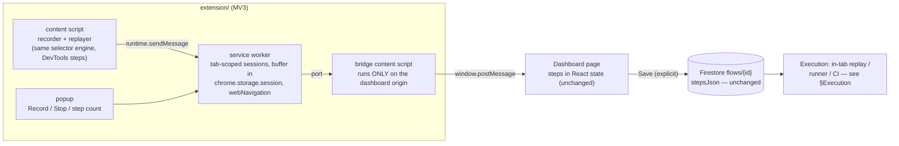
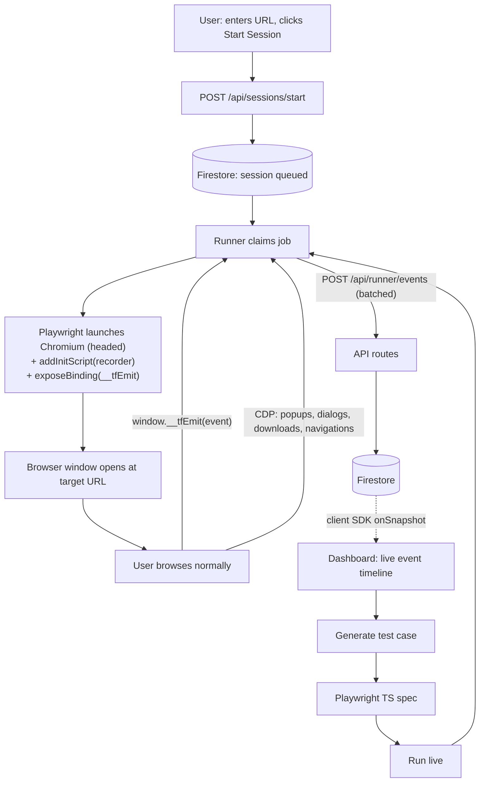

# TestFlow — Architecture & Flow Plan

**Last updated:** 2026-07-31

# v3 (current plan): Chrome extension recorder

The snippet/bookmarklet approach (v2) works but has structural limits: bookmarklets die
on hard navigations and under strict CSP, cross-origin iframes are invisible, new tabs
the dashboard didn't open are unreachable (no `opener` channel), and a dashboard-tab
reload loses the in-memory recording. An MV3 extension removes every one of those at the
cost of a one-time "load the extension" step. The **flow format, storage model, flows
UI, and codegen all stay exactly as they are** — only the capture layer changes.

## Flow



1. User clicks **Record** in the extension popup on *any* tab (or the dashboard's
   Record page asks the extension to open one). Recording is **tab-scoped**: SW maps
   `tabId → session`.
2. Content script (auto-injected on every page, `document_start`, `all_frames`)
   captures interactions as DevTools-format steps — the selector engine and step
   shapes from `public/tf-recorder.js` move over nearly verbatim.
3. Steps go to the service worker (`chrome.runtime.sendMessage`), which buffers them
   in `chrome.storage.session` (MV3 workers get evicted after ~30s idle — module-level
   memory is not durable) and adds what only the browser can see:
   `webNavigation` ground truth for `navigate`/`assertedEvents`, and new-tab tracking
   via `tabs.onCreated` — multi-tab flows record correctly now.
4. The **bridge** content script (matched only on the dashboard origin) relays the
   live step stream into the dashboard page via `window.postMessage` — the dashboard's
   existing message listener keeps working with a one-line source check change. No
   `externally_connectable`, no hardcoded extension ID.
5. Save stays explicit and unchanged: dashboard POSTs to `/api/flows`, steps stored as
   `stepsJson`. The popup can also save directly (SW `fetch` to the dashboard API —
   extensions with host permissions are exempt from CORS) and download raw JSON.

## Repo layout

`extension/` folder in this repo (a separate repo adds cross-repo type mirroring for
zero benefit at this stage; split when it needs its own release cycle / Web Store listing):

```
extension/
├─ manifest.json            # MV3
├─ build.mjs                # esbuild: bundles TS -> dist/, copies manifest
├─ src/
│  ├─ content/recorder.ts   # port of tf-recorder.js record+replay, minus opener logic
│  ├─ content/bridge.ts     # dashboard-origin relay (SW port <-> window.postMessage)
│  ├─ sw/index.ts           # sessions, buffering, webNavigation, tab tracking, save
│  ├─ popup/{popup.html,popup.ts}
│  └─ shared/flow.ts        # re-exports ../../src/types/flow.ts (same trick as runner)
└─ dist/                    # load this via chrome://extensions -> Load unpacked
```

Manifest essentials: `content_scripts` `<all_urls>` + `document_start` + `all_frames`,
bridge script matched on the dashboard origin(s), permissions `storage`, `tabs`,
`webNavigation`, `activeTab`; host_permissions `<all_urls>`. `debugger` permission is
**deferred** to the trusted-replay phase (§Execution) — it triggers a scary banner and
v1 doesn't need it.

## What gets scrapped vs kept

| Scrapped | Kept unchanged |
|---|---|
| Snippet / bookmarklet injection story | DevTools Recorder JSON format + `src/types/flow.ts` |
| `window.opener` postMessage hub in the Record page | Flows list/detail pages, `/api/flows`, `stepsJson` storage |
| Record page's `window.open` tab logic | `fromFlow.ts` Playwright codegen, runs + runner |
| `public/tf-recorder.js` as a served file (its logic moves into the content script) | `demo.html` (E2E fixture) and both E2E suites, retargeted at the extension |

Playwright can load MV3 extensions (`launchPersistentContext` +
`--load-extension`, supported in new headless), so the E2E suites keep running
headlessly in CI — the extension is testable the same way the agent was.

## Execution of test cases — see the Q&A in the conversation / table below

Recording and execution are now fully decoupled: the extension produces flows; anything
that speaks the DevTools format (or the generated Playwright) can execute them.

| Engine | Where it runs | Headed? | Cost | Fit |
|---|---|---|---|---|
| In-tab replay (content script) | user's browser | yes (visibly) | free | quick "does it still work" checks; synthetic events |
| Trusted replay (`chrome.debugger`) | user's browser | yes | free | phase 2: real CDP input, closes the `isTrusted` gap without any server |
| **`@puppeteer/replay`** | any Node box / CI | headless | free | runs the saved JSON **natively, zero codegen** |
| Playwright via local runner | dev machine | yes | free | already built ("Run with Playwright") |
| **GitHub Actions** | GitHub's runners | headless | free tier | scheduled runs + artifacts + no infra — the natural v4 for "scheduled testing" |
| Managed browsers (Browserbase / Browserless / Steel) | their cloud | live-view URL | metered | embedded live view in the dashboard |
| Checkly | their cloud | headless | free tier | Playwright checks on a schedule with alerting, API-driven |
| Vercel function + `playwright-core` + `@sparticuz/chromium` | Vercel | headless only | — | short smoke checks only; see limits in the Q&A |

## Build order

| Milestone | Deliverable |
|---|---|
| **E1** | Extension skeleton: manifest, esbuild, popup Record/Stop, content script logs steps |
| **E2** | Selector engine + full capture ported; SW buffering in `chrome.storage.session` |
| **E3** | `webNavigation` navigate/assertedEvents + multi-tab tracking |
| **E4** | Bridge → dashboard live stream; Record page rewritten to "extension status + live steps"; save path |
| **E5** | In-tab replay driven from the flow page through the extension (works on any site now) |
| **E6** | E2E suites retargeted (Playwright loads the extension); scrap v2 files |
| **E7** | Trusted replay via `chrome.debugger` (optional) |
| **E8** | Scheduled execution backend (GitHub Actions or managed — decision pending) |

---

# v2 (superseded by v3): client-side recording, DevTools Recorder format

The architecture pivoted after v1 was built. What changed and why:

| | v1 (runner-recorded) | v2 (current) |
|---|---|---|
| Browser | Playwright launches a Chromium **window** | Dashboard `window.open`s a **tab** of the user's own browser |
| Injection | `addInitScript` (works on any site) | Snippet on the site under test, or a bookmarklet |
| Transport | CDP binding → runner → API → Firestore | `postMessage` tab → dashboard, **in-memory state only** |
| Storage | every event streamed to Firestore | **nothing saved until the user clicks Save**; then one `flows/{id}` doc |
| Format | custom `RecordedEvent` | **Chrome DevTools Recorder JSON** exactly (`aria/`/`xpath/`/`pierce/`/`text/` selector groups, offsets, `assertedEvents`) — interoperable with DevTools and `@puppeteer/replay` |
| Replay | Playwright via runner | **In-browser**: the same agent executes steps in a fresh tab (synthetic events, React-safe value setters). Playwright via runner remains as the optional "run it for real" path. |

The physics that shaped v2: a web page cannot inject into a cross-origin tab
(same-origin policy — DevTools Recorder can only because it *is* the browser), so the
agent must already be in the page (snippet/bookmarklet), and `postMessage` is the one
channel a dashboard has to a tab it opened. Trade-off accepted: hard navigations kill a
bookmarklet-injected agent (snippet survives), and strict CSP can block the bookmarklet.

Key files: [public/tf-recorder.js](public/tf-recorder.js) (in-page agent: record +
replay), [src/types/flow.ts](src/types/flow.ts) (format + postMessage protocol),
[src/pages/index.tsx](src/pages/index.tsx) (hub), [src/pages/flows/](src/pages/flows/)
(saved flows + in-tab player), [src/codegen/fromFlow.ts](src/codegen/fromFlow.ts)
(flow → Playwright). Verified end-to-end headlessly: `npm run e2e` and
`npm run e2e:replay`.

The runner (`runner/`) is now only the optional Playwright execution engine ("Run with
Playwright" on a flow). Its v1 recording mode and the `sessions`/`testcases` API
routes still exist server-side but have no UI; strip them once the v2 flow settles.

Everything below is the v1 design document, kept for the reasoning that still applies
(runner constraints §10, Firestore discipline §8, quota notes).

---

# v1 design (superseded where it conflicts with the table above)

Start a recording session from the dashboard → a real browser opens with a recorder injected →
the user browses normally → events stream back live → convert to Playwright code → replay it live.

---

## 1. The one constraint that shapes everything

The flow as drawn has a step that can't be built literally:

> Opens a new browser tab/window → Injects your recorder script

A `window.open()` from your dashboard returns a handle to a **cross-origin** window. The same-origin
policy blocks you from touching its DOM, adding listeners, or injecting anything. This is the exact
wall that makes recorders ship as browser extensions in the first place. There is no flag, header,
or trick that opens it from a normal web page.

Two ways through, both of which preserve your flow exactly:

| | How | Trade-off |
|---|---|---|
| **A. Browser you control (CDP)** | Dashboard tells a Playwright process to launch Chromium with the recorder pre-injected via `addInitScript`. It's *your* browser, so injection is allowed on every page and frame. | Needs a process outside Vercel. **This is the plan.** |
| **B. Reverse proxy** | Serve the target site through your own domain, rewrite HTML/JS/URLs, inject the recorder. Now it's same-origin. | Breaks on CSP, cookies, OAuth redirects, service workers, most SPAs. Endless whack-a-mole. Rejected. |

Option A splits into two deployments of the same idea:

- **Local session (Phase 1)** — the browser opens as a real window **on the user's own machine**.
  A genuine "new browser window opens" — which is literally what your diagram says. No live view
  needed; the user just browses. Ships fastest, and it can reach `localhost` apps under test.
- **Hosted session (Phase 2)** — the browser runs in a container; the dashboard embeds an
  *interactive* live view (noVNC) so the user browses inside the dashboard tab.

Same recorder, same event schema, same driver interface. Phase 2 is a swapped implementation, not a
rewrite.

**What the pivot buys you:** the browser-control layer needed for test *playback* now also does the
*recording*. One piece of infrastructure, two modes. And multi-tab flows — which were flatly out of
scope with an extension — come almost free, because CDP sees every popup the session opens.

---

## 2. Flow



1. **Enter URL + Start Session** → API writes a `queued` session doc.
2. **Runner claims it** → launches headed Chromium with the recorder pre-injected.
3. **Browser opens** at the target URL.
4. **User browses normally** — real clicks, real typing, real logins.
5. **Recorder streams events** out through a CDP binding (§4), runner batches → API → Firestore.
6. **Dashboard updates in real time** via a Firestore `onSnapshot` subscription.
7. **Stop Session** from the dashboard, or by closing the browser window.
8. Convert → Playwright code → replay live.

---

## 3. Repos

The extension repo is gone. What's left:

| Piece | Where | Why |
|---|---|---|
| Dashboard — Next.js 16 Pages Router, API routes, Firebase Admin | `testflow` (this repo) | — |
| Runner — Playwright process: records **and** replays | `testflow/runner/` for now | Shares the event types, the recorder source, and the codegen. Splitting it now means mirroring all three across repos for no benefit. |

**Split point:** when the runner gets containerized for hosted sessions (Phase 2 / M7), extract it
to `testflow-runner` with its own Dockerfile and release cycle. Until then one repo, two
`package.json` files — `runner/` keeps Playwright entirely out of the Next.js dependency tree.

```
testflow/
├─ src/
│  ├─ pages/
│  │  ├─ index.tsx                    # start a session: URL input + Start button
│  │  ├─ sessions/index.tsx           # session history
│  │  ├─ sessions/[id].tsx            # LIVE event timeline (onSnapshot) + Stop + Generate
│  │  ├─ testcases/[id].tsx           # step list + code editor + Run
│  │  ├─ runs/[id].tsx                # playback: live view + step log
│  │  └─ api/                         # §6
│  ├─ components/
│  │  ├─ Layout.tsx                   # shell, nav, Card/Button/ErrorNote primitives
│  │  ├─ EventTimeline.tsx            # the live event feed
│  │  └─ StatusBadge.tsx              # queued / launching / recording / stopped / error
│  ├─ hooks/
│  │  └─ usePoll.ts                   # the realtime mechanism — see §7
│  ├─ lib/
│  │  ├─ firebase-admin.ts            # server only, singleton + collection refs
│  │  ├─ auth.ts                      # runner token (constant-time compare)
│  │  ├─ api.ts                       # envelope, method guard, body validation
│  │  ├─ client.ts                    # browser fetch helper
│  │  └─ validate.ts                  # zod schema per request body
│  ├─ codegen/
│  │  ├─ normalize.ts                 # raw events -> clean steps
│  │  ├─ selector.ts                  # pick best candidate, score brittleness
│  │  └─ emit.ts                      # steps -> Playwright TS
│  └─ types/
│     ├─ events.ts                    # the shared contract
│     └─ models.ts                    # Firestore doc shapes + step IR
├─ scripts/
│  └─ codegen-smoke.ts                # exercises the pipeline with no Firebase
└─ runner/
   ├─ package.json                    # playwright lives HERE, not in the root
   ├─ build-recorder.ts               # esbuild -> single IIFE string for addInitScript
   └─ src/
      ├─ index.ts                     # claim loop: poll for queued sessions & runs
      ├─ config.ts                    # runner/.env, no dotenv dependency
      ├─ api.ts                       # typed client for /api/runner/*
      ├─ record.ts                    # launch + inject + stream
      ├─ replay.ts                    # spawn `playwright test` on a generated spec
      ├─ shared/events.ts             # re-exports the dashboard's contract
      └─ recorder/
         ├─ recorder.ts               # THE INJECTED SCRIPT (runs in page context)
         └─ selector-engine.ts        # candidate generation + scoring, in-page
```

Installed — root: `firebase-admin`, `zod`, `tsx`. `runner/`: `playwright`,
`@playwright/test`, `esbuild`, `tsx`.

Two things the original sketch listed that were dropped: **Prettier** (the step list is
linear, so `emit.ts` produces already-formatted source — no reformatter needed) and a
**code-editor library** (a monospace `<textarea>` covers a read-mostly surface; add
CodeMirror when editing becomes the main activity).

The `driver/` split is deferred too: with only a local driver implemented, the interface
would be an abstraction over one case. §11 defines it; extract it when the container
driver lands.

---

## 4. Recording: injection and transport

This is the core mechanism. Two Playwright calls do the heavy lifting.

```ts
const context = await chromium.launchPersistentContext(profileDir, {
  headless: false,
  viewport: null,          // real window size
});

// 1. A callback the page can reach — bound before any navigation.
await context.exposeBinding('__tfEmit', (source, event) => {
  buffer.push({ ...event, pageId: pageIdOf(source.page), framePath: framePathOf(source.frame) });
});

// 2. The recorder, re-injected on every navigation, in every frame, before page scripts run.
await context.addInitScript({ content: RECORDER_IIFE });

const page = await context.newPage();
await page.goto(targetUrl);
```

**Why `exposeBinding` instead of `fetch` from the page.** The recorder runs inside the *target
site's* origin. A `fetch` to your API from there hits two walls: CORS, and — worse — the target
site's own `Content-Security-Policy: connect-src`, which you don't control and can't override. A
CDP binding is a direct function call into the Node process. No network, no CORS, no CSP, no way for
the page's policy to interfere. This is the single most important choice in the recording path.

**Why `addInitScript`.** It runs before any page script on *every* navigation and *every* frame,
including iframes and popups, for the lifetime of the context. Register once at launch and full-page
reloads, SPA route changes, and `window.open` targets are all covered with no re-injection logic.

**CDP-level capture.** Some things the DOM can't tell you. Subscribe on the runner side and merge
into the same stream:

| Playwright event | Recorded as | Why it matters |
|---|---|---|
| `context.on('page')` | `newtab` | Popups and `target=_blank` — the multi-tab flows an extension couldn't follow |
| `page.on('framenavigated')` | `navigate` | Ground truth for SPA and hard navigations |
| `page.on('dialog')` | `dialog` | `alert`/`confirm`/`prompt` — needs a handler in generated code |
| `page.on('download')` | `download` | |
| `page.on('console')` / `pageerror` | diagnostics | Shown in the timeline, not compiled into the test |
| `context.on('close')` | session ended | User closed the window = Stop |

**Buffering.** Runner flushes to `/api/runner/events` at 50 events / 2s / stop, whichever is first.
Each event carries a uuid used as the Firestore doc id, so a retried batch overwrites instead of
duplicating.

**Note on trust.** `window.__tfEmit` is visible to the page, so a hostile site could forge events.
Irrelevant for testing sites you own; worth remembering if this ever points at untrusted targets.

### What the injected recorder captures

| DOM event | Recorded as | Handling |
|---|---|---|
| `click` | `click` | capture phase; ignore `isTrusted === false` |
| `dblclick` / `contextmenu` | `dblclick` / `rightclick` | supersedes the preceding click(s) |
| `input` | `input` | debounce 400ms, keep only the **final** value per element |
| `change` on `<select>` | `select` | option value + label |
| `change` on file input | `upload` | filename only — contents can't be replayed |
| `keydown` | `press` | Enter, Tab, Escape, arrows, Ctrl/Cmd combos only |
| `scroll` | `scroll` | throttle 250ms, last-per-container (mostly dropped at codegen) |
| `submit` | `submit` | |
| resize | `viewport` | the first one becomes the test's viewport |
| Alt+Click | `assert` | assert mode: visible / text equals / value equals / URL |

**Masking.** `input[type=password]`, `autocomplete` containing `cc-` or `one-time-code`, and
anything in the session's redaction list record `value: null, masked: true`. Generated code emits
`process.env.TEST_PASSWORD!` — never a literal. This matters more now than with an extension,
because users will log into real accounts inside these sessions.

### Selector engine

Compute **all** candidates in-page at record time and ship the ranked list. The DOM is gone by the
time the dashboard renders the event, so a selector that turns out brittle can't be re-derived
later — but a stored candidate list lets the UI offer a dropdown to swap it.

1. `data-testid` / `data-test` / `data-cy` → `getByTestId('x')`
2. Role + accessible name → `getByRole('button', { name: 'Save' })`
3. `<label>` / `aria-label` / placeholder → `getByLabel` / `getByPlaceholder`
4. Stable `#id` — reject generated-looking ids (`/^(:r|ember|mui-|radix-)/`, long hex/uuid)
5. Unique visible text → `getByText('…', { exact: true })`
6. Scoped CSS path with `:nth-child` — fallback, flagged `brittle: true`

Each candidate: `{ kind, value, name?, unique, score }`. Score picks the default; the rest populate
the swap dropdown.

---

## 5. Event contract (`src/types/events.ts`)

Now a normal internal module — no cross-repo mirroring, since the recorder lives in this repo. Keep
`schemaVersion` anyway; old sessions in Firestore outlive schema changes.

```ts
export const SCHEMA_VERSION = 1;

export type SelectorCandidate = {
  kind: 'testid' | 'role' | 'label' | 'placeholder' | 'id' | 'text' | 'css';
  value: string;
  name?: string;        // accessible name, for kind === 'role'
  unique: boolean;      // matched exactly one node at record time
  score: number;        // 0-100, higher = more durable
};

export type RecordedEvent = {
  id: string;           // uuid — Firestore doc id, gives idempotent retries
  seq: number;          // monotonic per session
  ts: number;
  pageId: string;       // which tab — set by the runner, not the page
  framePath: number[];  // [] = top frame, [0,2] = nested iframe
  type: 'click' | 'dblclick' | 'rightclick' | 'input' | 'select' | 'press'
      | 'scroll' | 'submit' | 'upload' | 'viewport' | 'assert'
      | 'navigate' | 'newtab' | 'dialog' | 'download';   // last four: CDP-sourced
  url: string;
  target?: {
    selectors: SelectorCandidate[];
    tag: string;
    type?: string;
    text?: string;      // trimmed, max 120 chars
    role?: string;
    boundingBox?: { x: number; y: number; w: number; h: number };
  };
  value?: string | null;
  masked?: boolean;
  key?: string;
  scroll?: { x: number; y: number };
  viewport?: { width: number; height: number };
  dialog?: { kind: 'alert' | 'confirm' | 'prompt'; message: string; accepted: boolean };
  assert?: { kind: 'visible' | 'hidden' | 'text' | 'value' | 'url'; expected: string };
};
```

---

## 6. API routes (`src/pages/api/`)

No CORS anywhere — everything is same-origin (dashboard) or server-to-server (runner). That's a real
simplification over the extension design.

**Session control (dashboard → server)**

| Route | Method | Purpose |
|---|---|---|
| `/api/sessions/start` | POST | `{ url, name?, viewport?, redactSelectors? }` → creates a `queued` session → `{ sessionId }` |
| `/api/sessions/[id]/stop` | POST | Flags `stopRequested`; the runner closes the browser |
| `/api/sessions` | GET | History, paginated |
| `/api/sessions/[id]` | GET / DELETE | Meta / cascade delete events |
| `/api/sessions/[id]/events` | GET | Ordered by `seq` — for replay/export; the live view uses `onSnapshot` |

**Runner (runner ↔ server, `x-runner-token` auth)**

| Route | Method | Purpose |
|---|---|---|
| `/api/runner/claim` | POST | Long-poll for the next `queued` session or run. Atomic claim via a Firestore transaction so two runners can't take the same job |
| `/api/runner/session/[id]/status` | POST | `launching` → `recording` → `stopped` / `error` |
| `/api/runner/events` | POST | Batched `RecordedEvent[]` |
| `/api/runner/report` | POST | Playback step results and log lines |
| `/api/runner/artifact-url` | POST | Signed Storage upload URL for trace / video |

**Test cases & playback**

| Route | Method | Purpose |
|---|---|---|
| `/api/testcases/generate` | POST | `{ sessionId, options }` → normalize + emit → new test case |
| `/api/testcases` | GET | List |
| `/api/testcases/[id]` | GET / PATCH / DELETE | PATCH saves edited code or a swapped selector |
| `/api/runs` | POST | `{ testcaseId, headed }` → `{ runId, liveViewUrl }` |
| `/api/runs/[id]` | GET | Status, steps, artifacts |
| `/api/runs/[id]/stop` | POST | Cancel |

**On the claim loop.** Long-polling suits a local runner and needs no extra infrastructure. It does
hold a Node connection open, which serverless dislikes — so cap the poll at ~25s and let the runner
re-poll. If the runner ever moves fully hosted, swap to Cloud Tasks or a Pub/Sub push.

---

## 7. Realtime to the dashboard

"Dashboard updates in real time" — the cheapest correct answer is **not** WebSockets. Vercel's
serverless functions don't hold sockets well, and SSE through a Next.js API route is awkward there.

**What's built: cursor-based polling.** The timeline requests
`GET /api/sessions/[id]/events?since=<lastSeq>` once a second while a session is active, and
appends whatever comes back. `usePoll` chains with `setTimeout` rather than `setInterval`, so a
slow request can never stack overlapping polls, and it stops entirely once the session is no
longer recording.

```ts
// sessions/[id].tsx — cursor lives in a ref so the poll closure always sees the newest value
const data = await apiFetch(`/api/sessions/${id}/events?since=${cursor.current}`);
if (data.events.length > 0) {
  cursor.current = data.lastSeq;
  setEvents((previous) => [...previous, ...data.events]);
}
```

**Why this over the Firestore `onSnapshot` originally sketched.** The client SDK path needs
`NEXT_PUBLIC_*` config, security rules that expose `sessions/{id}/events` for reading, and a second
auth story — a meaningful amount of setup for a page that is only ever open while a human watches a
browser they just launched. A one-second cursor poll is indistinguishable to that human, adds no
config, and keeps *every* Firestore access behind the Admin SDK, which makes the deny-all rule in §8
literally true rather than aspirational.

The cursor is what makes it cheap: each poll reads only events newer than the last one, so cost is
proportional to what was recorded, not to how long the page stayed open.

**When to switch to `onSnapshot`.** Once the dashboard has real user auth (so rules can scope reads
to a project) or once multiple people watch the same session — at that point the subscription is
both cheaper and genuinely push-based. `usePoll` is the only thing that changes.

---

## 8. Firestore model

```
projects/{projectId}
  name, runnerTokenHash, createdAt

sessions/{sessionId}
  projectId, schemaVersion, targetUrl, name,
  status: 'queued'|'launching'|'recording'|'stopped'|'error',
  stopRequested: boolean, claimedBy: runnerId|null, claimedAt,
  viewport, userAgent, redactSelectors[],
  createdAt, startedAt, endedAt, eventCount, error?
  └─ events/{eventId}          ← subcollection: RecordedEvent + serverTs

testcases/{testcaseId}
  projectId, sourceSessionId, name, description,
  steps: NormalizedStep[],     ← editable intermediate representation
  code: string,                ← generated Playwright TS
  codeEditedManually: boolean, createdAt, updatedAt

runs/{runId}
  testcaseId, projectId, status: 'queued'|'running'|'passed'|'failed'|'cancelled',
  driver: 'local'|'container', liveViewUrl, startedAt, finishedAt,
  summary: { total, passed, failed }, artifacts: { trace?, video?, screenshots[] }
  └─ logs/{logId}

schedules/{scheduleId}         ← later
  testcaseId, cron, timezone, enabled, lastRunId, nextRunAt
```

- Events are a **subcollection**, never an array field — a session blows past the 1MB doc limit fast.
- `writeBatch` caps at 500 ops; the ingest route chunks at 400 and runner batches are 50.
- **No composite indexes are required, by design.** Every query is either a single equality filter
  (`status == 'queued'`, then sorted in memory over ≤10 candidates) or a range + sort on the *same*
  field (`seq > cursor` ordered by `seq`). Both are served by Firestore's automatic single-field
  indexes. This is worth preserving: a composite index means a console round-trip and a
  failed-query error for whoever sets the project up next.
- **Rules: deny all client access.** With realtime served by polling through API routes (§7),
  nothing reaches Firestore except the Admin SDK — the deny-all default needs no exceptions.
- Ids are meaningful: an event's doc id is its own uuid and a log's is `log-<seq>`, so a retried
  batch overwrites instead of duplicating. Retry safety is a property of the schema, not of
  the retry logic.
- Storage: `runs/{runId}/trace.zip`, `video.webm`, `screenshots/*.png`. Short-TTL signed URLs only —
  the bucket stays private. *(Not yet wired: artifacts currently stay on the runner's disk.)*

---

## 9. Events → Playwright

Deterministic transform, not an LLM: reproducible, debuggable, no API dependency. An optional
"clean up with AI" pass on top is a fine later addition — the baseline must not need it.

**Normalize** (`codegen/normalize.ts`), in order:

1. Drop `scroll` events — Playwright auto-scrolls into view; recorded scrolls are noise.
2. Collapse a run of `input` on the same target into one `fill(finalValue)`.
3. Drop a `click` immediately followed by `input` on that same element (focus click).
4. Collapse `click` on `<label>` + the resulting control click into one.
5. First `navigate` → `page.goto(url)`. Later ones → `expect(page).toHaveURL(…)` (the click caused it).
6. Drop `press` events that already produced a `submit`.
7. `newtab` → `const [popup] = await Promise.all([context.waitForEvent('page'), …click])`, and
   subsequent events on that `pageId` retarget to `popup`.
8. `dialog` → emit a `page.on('dialog', d => d.accept())` handler **before** the triggering step.
9. Insert `expect(locator).toBeVisible()` before the first interaction on each new URL as a cheap
   implicit wait. Never emit `waitForTimeout`.
10. `assert` events map straight to `expect(...)`.

Output is `NormalizedStep[]`, stored on the test case so the UI can render an editable step list
independent of the code text.

**Select**: highest-scoring `unique` candidate per step; if none is unique, best CSS path marked
`brittle` so the UI can flag it.

**Emit**: steps → TS → Prettier.

```ts
import { test, expect } from '@playwright/test';

test('checkout — guest user', async ({ page }) => {
  await page.setViewportSize({ width: 1512, height: 856 });
  await page.goto('https://example.com/products');

  await page.getByRole('button', { name: 'Add to cart' }).click();
  await page.getByTestId('cart-icon').click();
  await expect(page).toHaveURL(/\/cart/);

  await page.getByLabel('Email').fill('test@example.com');
  await page.getByLabel('Password').fill(process.env.TEST_PASSWORD!);
  await page.getByRole('button', { name: 'Continue' }).click();

  await expect(page.getByText('Order confirmed')).toBeVisible();
});
```

Step list and code render side by side. Editing a step regenerates the code; editing code directly
sets `codeEditedManually: true` so regeneration stops clobbering it.

---

## 10. Playback

Same runner, second mode — `replay.ts` instead of `record.ts`. Constraints worth stating once:

- **Playwright cannot run on Vercel serverless** — binaries and execution time exceed the function
  limits. That's why the runner exists as its own process, and why `playwright` stays out of the
  root `package.json`.
- **You cannot iframe the site under test.** `X-Frame-Options` / `frame-ancestors` blocks most real
  targets. Any embedded view must show the *browser's* live view — a screencast or VNC surface the
  runner serves — never the target URL.
- **An https dashboard cannot reach a `http://localhost` runner** (mixed content). Local runner
  pairs with a local dashboard; hosted dashboard needs a hosted browser.

Phase 1: playback runs headed in a local window, exactly like recording — the user watches the real
window, and the dashboard streams step-by-step pass/fail through Firestore. Phase 2: container
driver returns an https noVNC URL and `LiveView.tsx` embeds it.

Afterwards, upload `trace.zip` + `video.webm` to Storage and link them from the run page. The
Playwright trace viewer is the best failure-debugging surface available and it costs nothing.

---

## 11. Hosted sessions (Phase 2)

For recording, hosted is strictly harder than playback, because the user must **interact** with the
remote browser, not just watch it. That means input forwarding.

- **noVNC** (Docker: `mcr.microsoft.com/playwright` + Xvfb + x11vnc + noVNC on Fly.io / Railway) —
  bidirectional out of the box, embeds as a plain iframe. Recommended for self-hosting.
- **Managed** (Browserbase / Steel / Browserless) — hand back an interactive live-view URL built for
  iframe embedding. Faster to ship, metered per browser-hour.
- **DIY CDP screencast + `Input.dispatchMouseEvent`** — full control, but you're reimplementing VNC.
  Only worth it if you need a custom overlay drawn over the live view.

One session driver interface covers all of it:

```ts
export interface SessionDriver {
  launch(opts: { url: string; viewport?: Viewport }): Promise<{ liveViewUrl: string | null }>;
  onEvent(cb: (e: RecordedEvent) => void): void;
  stop(): Promise<void>;
}
```

`LocalDriver` returns `liveViewUrl: null` (the window is right there on the desktop);
`ContainerDriver` returns a URL. The dashboard renders a live view when there's a URL and a
"check your browser window" hint when there isn't. That's the only branch in the UI.

---

## 12. Environment

`.env.local` (already gitignored):

```
FIREBASE_PROJECT_ID=
FIREBASE_CLIENT_EMAIL=
FIREBASE_PRIVATE_KEY=            # \n-escaped
FIREBASE_STORAGE_BUCKET=
NEXT_PUBLIC_FIREBASE_API_KEY=    # client SDK — realtime subscriptions only
NEXT_PUBLIC_FIREBASE_PROJECT_ID=
RUNNER_TOKEN=                    # shared secret for /api/runner/*
```

`runner/.env`:

```
DASHBOARD_URL=http://localhost:3000
RUNNER_TOKEN=
RUNNER_ID=local-1
BROWSER_PROFILE_DIR=./.profiles   # persistent profile: log in once, reuse the session
```

A persistent profile dir is a small detail with a big payoff — the user logs into the site under
test once, and every later recording session starts already authenticated.

---

## 13. Later: scheduled testing

Additive, no refactor, provided these hooks exist now:

- `schedules` collection (§8).
- Vercel Cron → `/api/cron/tick` every 5 min: query `enabled == true and nextRunAt <= now`, enqueue
  runs, advance `nextRunAt`.
- Scheduled runs are **headless** — `SessionDriver` already returns `liveViewUrl: null`, so nothing
  else changes.
- Failure notifications (email / Slack webhook) read the run summary.

---

## 14. Build order

| Milestone | Deliverable | Status |
|---|---|---|
| **M0** | Firebase Admin wiring, runner token, `/api/health` | ✅ built |
| **M1** | Runner skeleton + transactional claim loop | ✅ built |
| **M2** | Launch + `addInitScript` + `exposeBinding` | ✅ built |
| **M3** | Selector engine + full DOM capture + masking | ✅ built |
| **M4** | Ingest route + batching + CDP-level events | ✅ built |
| **M5** | Start Session UI + live timeline + Stop | ✅ built — **the flow diagram works end to end** |
| **M6** | Normalizer + codegen + step/code editor | ✅ built — verified by `npm run smoke:codegen` |
| **M7** | Replay mode + streamed step log | ✅ built; artifact **upload** to Storage still open |
| **M8** | Container driver + interactive noVNC live view | ⬜ not started |
| **M9** | Scheduling + notifications | ⬜ not started |

Everything through M7 runs locally today. What M8 buys is the hosted case: recording and
replaying from a deployed dashboard instead of a browser on your own machine.

Verify with `npm run typecheck`, `npm run lint`, `npm run smoke:codegen`, and
`npm --prefix runner run typecheck`.

---

## 15. Open decisions

- **Dashboard auth** — MVP can be a single shared secret. Firebase Auth (Google sign-in) is the
  natural upgrade and reuses the Firebase project already in play.
- **Runner distribution** — `npx testflow-runner` (published package) vs "clone the repo and
  `npm run runner`". Publishing matters only once someone other than you runs it.
- **Managed vs self-hosted browser** for Phase 2 — deferred to M8; the `SessionDriver` interface
  makes it a one-file swap.
- **Code editor** — CodeMirror 6 (light) vs Monaco (full IntelliSense). CodeMirror is likely right
  for a read-mostly surface.
